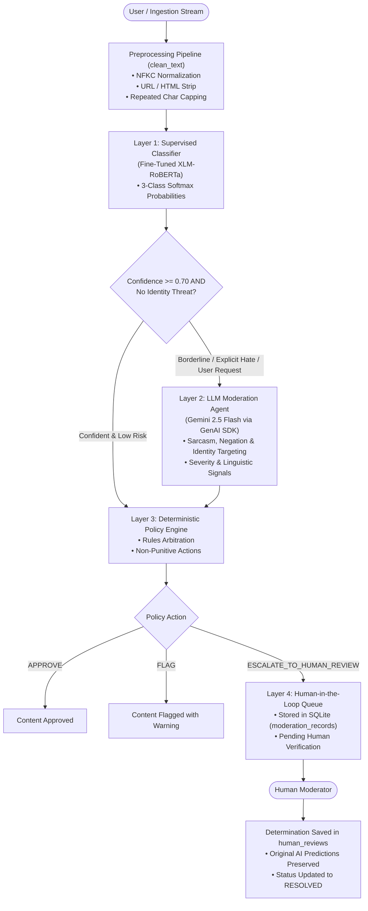

# 🛡️ HinglishGuard AI: Hybrid Transformer & LLM Agent Content Moderation System

[](https://www.python.org/)
[](https://pytorch.org/)
[](https://huggingface.co/)
[](https://ai.google.dev/)
[](https://streamlit.io/)
[](LICENSE)

An enterprise-grade, hybrid content moderation and hate speech detection platform designed specifically for **code-mixed Hindi-English (Hinglish)** social discourse.

HinglishGuard AI bridges the gap between high-throughput supervised classification and nuanced contextual reasoning. It combines a fine-tuned **XLM-RoBERTa** multilingual transformer with a **Google Gemini 2.5 Flash** contextual moderation agent and a **deterministic Policy Engine** with a **Human-in-the-Loop (HITL)** review queue.

---

## 📌 Problem Statement & Motivation

Code-mixed Hindi-English (**Hinglish**) is one of the fastest-growing forms of communication across South Asian social media. Traditional keyword blocklists and standard English/Hindi NLP classifiers fail catastrophically on Hinglish due to:
1. **Unstandardized Phonetic Spelling**: Variations like *kutta*, *kuttaa*, *kuttey*, and *qutta*.
2. **Grammatical Code-Mixing**: Unpredictable intra-sentential switching between Hindi syntax, English vocabulary, and regional vernaculars.
3. **Contextual & Semantic Ambiguity**: General vulgar personal insults (*"tu stupid chutiya hai"*) vs. targeted communal or religious hate speech (*"ye log desh ke gaddar hain"*).
4. **Subtle & Implicit Incitement**: Clean syntactic phrasing that advocates hatred or dehumanization without using explicit profanity (e.g., *"People from this community should be hated"*).

HinglishGuard AI solves this with a **three-tier hybrid architecture**: supervised transformer classification handles latency-critical surface screening, an LLM agent resolves deep cultural/identity context, and a deterministic policy engine arbitrates decisions and routes ambiguities to human moderators.

---

## ✨ Key Features

- **Three-Class Taxonomy**: Categorizes discourse strictly into `Neutral` (0), `Offensive` (1), or `Hate` (2).
- **Fine-Tuned XLM-RoBERTa Engine**: High-accuracy contextual embeddings with dynamic sequence padding (128 tokens) and class-weighted cross-entropy loss.
- **TF-IDF + Logistic Regression Baseline**: Optimized character n-gram (3–5) baseline ($C=5.0$) achieving 89.23% test accuracy.
- **Contextual Gemini AI Moderation Agent**: Employs Google GenAI SDK (`gemini-2.5-flash`) with Pydantic structured output to detect identity targeting, target groups, severity, and cultural nuances without fabricating analysis.
- **Deterministic Policy Engine**: Enforces strict safety rules, uncertainty thresholds ($< 0.70$), and disagreement arbitration without automatically deleting content or banning users.
- **Human-in-the-Loop Review Queue**: Dedicated audit dashboard enabling human moderators to arbitrate flagged items, log notes, and update records to `RESOLVED` while preserving original model outputs.
- **Real-Time Analytics Dashboard**: Visualizes operational telemetry, throughput trends, mean category confidence, and searchable audit logs using interactive Plotly charts.
- **Robust Windows AMD64 Compatibility**: Replaces PyArrow-dependent dataframe rendering with Plotly figures and styled HTML tables to circumvent OS Application Control DLL load blocks (`WinError 4551`).

---

## 🏛️ System Architecture & Workflow



---

## 🛠️ Technology Stack

| Domain | Technology / Library | Purpose |
| :--- | :--- | :--- |
| **Language** | Python 3.12 (Windows AMD64) | Core application and testing runtime |
| **Deep Learning** | PyTorch 2.1+ & Hugging Face Transformers | XLM-RoBERTa tokenization, fine-tuning, and CPU inference |
| **Machine Learning** | Scikit-Learn & Joblib | TF-IDF vectorization, Logistic Regression baseline, and metrics |
| **GenAI & LLMs** | Google GenAI SDK (`google.genai`) | Gemini 2.5 Flash agent with structured Pydantic schema |
| **Frontend UI** | Streamlit 1.67+ & Plotly | Interactive multi-page dashboard, telemetry heatmaps, and charts |
| **Database** | SQLite & SQLAlchemy 2.0+ ORM | Persistent moderation records, review queue, and audit trail |
| **Text Processing** | Regex, NLTK, unicodedata (NFKC) | Hinglish code-mixed cleaning and token normalization |
| **Testing** | Pytest 9.2+ | Automated unit, integration, and end-to-end verification (75 tests) |

---

## 📊 Dataset Attribution & Licensing

HinglishGuard AI was developed and evaluated using the **Indo-HateSpeech** benchmark corpus:
- **Reference**: Kaware, S. (2024). *Indo-HateSpeech: A Code-Mixed Dataset for Hate Speech and Offensive Language Detection in Hindi-English Discourse*.
- **Dataset Size**: 57,262 cleaned samples partitioned into an isolated 70% / 15% / 15% split:
  - **Train**: 40,083 samples
  - **Validation**: 8,589 samples
  - **Test**: 8,590 samples (strictly isolated; zero data leakage)
- **License / Redistribution**: The Indo-HateSpeech dataset is distributed under academic research terms. To respect licensing boundaries, raw data files (`.csv`) are excluded from this repository. Users can reproduce the exact dataset partition using the instructions in `data/processed/transformer_training_guide.md`.
- **Provisional Label Mapping**:
  - `HS0` $\rightarrow$ **Neutral (0)**: Benign conversational text, friendly banter, factual reporting.
  - `HS1` $\rightarrow$ **Offensive (1)**: Vulgar slang, non-targeted swearing, personal insults.
  - `HSN` $\rightarrow$ **Hate (2)**: Targeted communal hostility, religious attacks, incitement.

---

## 📈 Model Performance & Evaluation

Models were evaluated strictly on the **unseen 8,590-sample test set** (`data/processed/test.csv`).

### Global Benchmark Comparison

| Metric | TF-IDF Baseline (Char 3–5, C=5.0) | XLM-RoBERTa (Fine-Tuned) | Delta Improvement |
| :--- | :---: | :---: | :---: |
| **Test Accuracy** | 89.23% | **93.67%** | **+4.44%** |
| **Macro Precision** | 73.33% | **86.92%** | **+13.59%** |
| **Macro Recall** | 76.02% | **92.98%** | **+16.96%** |
| **Macro F1 (Primary Metric)** | 74.60% | **89.59%** | **+14.99%** |
| **Weighted F1** | 89.49% | **93.95%** | **+4.46%** |

### Per-Class Detailed Breakdown (XLM-RoBERTa vs. Baseline)

| Class | Baseline F1 | XLM-RoBERTa F1 | F1 Improvement | Key Behavioral Insight |
| :--- | :---: | :---: | :---: | :--- |
| **Neutral (0)** | 95.43% | **96.55%** | +1.12% | High reliability on safe conversational discourse |
| **Offensive (1)** | 71.34% | **81.90%** | +10.56% | Accurately isolates general profanity from hate |
| **Hate (2)** | 57.04% | **90.32%** | **+33.28%** | **Drastic reduction in false negatives on communal attacks** |

### 3×3 Confusion Matrix (XLM-RoBERTa on Test Set)

| Actual \ Predicted | Pred Neutral | Pred Offensive | Pred Hate |
| :--- | :---: | :---: | :---: |
| **Actual Neutral** | **224** | 14 | 0 |
| **Actual Offensive** | 2 | **43** | 2 |
| **Actual Hate** | 0 | 1 | **14** |

---

## 🖥️ Application Interface Overview

The Streamlit web application is structured into six modular pages:

1. **Dashboard (`app.py`)**: Executive telemetry, system infrastructure health indicators, model availability status, and recent moderation audit tables.
2. **1. Analyze Text (`pages/1_Analyze_Text.py`)**: Production single-text classification using XLM-RoBERTa with live probability distributions and on-demand Gemini AI contextual analysis.
3. **2. Model Lab (`pages/2_Model_Lab.py`)**: In-depth benchmark comparisons, interactive confusion matrices, and a live side-by-side inference arena with CPU latency timers.
4. **3. AI Moderation Agent (`pages/3_AI_Moderation_Agent.py`)**: Parallel multi-agent evaluation hub inspecting identity targeting, severity, and policy arbitration.
5. **4. Human Review (`pages/4_Human_Review.py`)**: HITL review queue allowing human moderators to inspect flagged content, record audit notes, and override classifications without deleting AI predictions.
6. **5. Analytics (`pages/5_Analytics.py`)**: System-wide throughput trends, confidence distributions, and full-text searchable audit logs.

### UI Preview
```
+------------------------------------------------------------------------------------+
| 🛡️ HinglishGuard AI Dashboard                                                      |
| [Status: XLM-RoBERTa Active]  [TF-IDF Baseline Ready]  [Gemini Agent Configured]   |
+------------------------------------------------------------------------------------+
| Total Analyzed: 1,240   Pending Review: 12   Resolved: 48   Disagreements: 14      |
+------------------------------------------------------------------------------------+
| [Class Distribution Chart]            | [Policy Actions: APPROVE / FLAG / ESCALATE]|
+------------------------------------------------------------------------------------+
```

---

## 🚀 Installation & Setup (Windows AMD64)

### Prerequisites
- Windows 10/11 (64-bit)
- Python 3.12 (Python 3.12.10 recommended)
- Git for Windows

### Step 1: Clone the Repository
```powershell
git clone https://github.com/yourusername/hinglishguard-ai.git
cd hinglishguard-ai
```

### Step 2: Create and Activate Virtual Environment
```powershell
python -m venv .venv
.\.venv\Scripts\Activate.ps1
```

### Step 3: Install Dependencies
```powershell
pip install --upgrade pip
pip install -r requirements.txt
```

### Step 4: Configure Environment Variables
Copy `.env.example` to `.env`:
```powershell
copy .env.example .env
```
Open `.env` in any text editor and supply your Google Gemini API key:
```ini
# Google Gemini API Configuration
GEMINI_API_KEY=your_gemini_api_key_here
GEMINI_MODEL=gemini-2.5-flash

# Application Settings
APP_ENV=development
DATABASE_URL=sqlite:///data/moderation.db
```
*(Note: If no API key is provided, the application runs normally using the supervised models and gracefully disables contextual LLM analysis without crashing).*

### Step 5: Obtain Model Checkpoints
Due to GitHub file size limits, large model weights (`model.safetensors`, 1.11 GB) are not checked into Git.
- **Option A (Train on Google Colab GPU)**: Run the provided cloud notebook following [`data/processed/transformer_training_guide.md`](file:///c:/Users/mritu/OneDrive/Documents/projects/Hate%20Speech%20Detection/data/processed/transformer_training_guide.md) and download the resulting `best_model/` folder to `models/transformers/xlm_roberta_hinglish/best_model/`.
- **Option B (Run with Baseline)**: If transformer weights are not present, the application operates in lightweight baseline mode using `models/baseline/`.

### Step 6: Launch the Streamlit Application
```powershell
streamlit run app.py
```
Open your browser at `http://localhost:8501`.

---

## 🧪 Testing Suite

The project includes 75 automated unit, integration, and end-to-end tests covering data cleaning, database transactions, model loading, policy arbitration, mock LLM evaluations, and Streamlit helpers.

To run the complete test suite:
```powershell
.\.venv\Scripts\python.exe -m pytest -v
```

All 75 tests run with fully mocked model weights and mocked API responses, executing in under 90 seconds without requiring a GPU or active internet connection.

---

## ⚠️ Known Limitations & Future Roadmap

- **Implicit Identity-Hate in Supervised Head**: As documented in `data/processed/false_negative_investigation_report.md`, the supervised classifier relies heavily on explicit vulgar slurs. Syntactically clean English statements advocating hate (e.g. *"People from this community should be hated"*) are caught by the **Gemini Moderation Agent** and escalated by the **Policy Engine**, proving the necessity of the hybrid design.
- **CPU Inference Latency**: XLM-RoBERTa inference takes $\approx 900$ ms per sample on a modern multi-core CPU. GPU acceleration is recommended for high-volume production queues.
- **Future Improvements**:
  - Fine-tuning with Focal Loss ($\gamma = 2.0$) to penalize overconfident easy negatives on imbalanced classes.
  - Active learning pipeline feeding human-reviewed disagreements back into periodic model fine-tuning.
  - Containerization via Docker for multi-platform orchestration.

---

## 👤 Author

Developed by **[Your Name]**
- **GitHub**: [github.com/yourusername](https://github.com/yourusername)
- **LinkedIn**: [linkedin.com/in/yourprofile](https://linkedin.com/in/yourprofile)
- **Project Repository**: [github.com/yourusername/hinglishguard-ai](https://github.com/yourusername/hinglishguard-ai)

---

## 📄 License

This project is licensed under the MIT License — see the [LICENSE](LICENSE) file for details. Dataset usage is subject to the research licensing terms of the original Indo-HateSpeech benchmark corpus.
