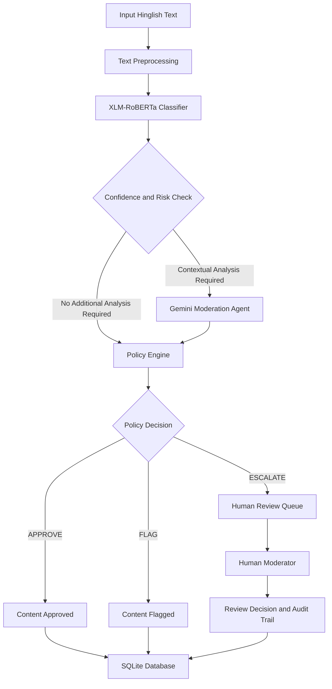

# 🛡️ HinglishGuard AI
### Hybrid Transformer-Based Hinglish Hate Speech Detection & Intelligent Content Moderation


**HinglishGuard AI** is a hybrid AI-powered hate speech detection and content moderation system designed specifically for Hindi-English code-mixed (Hinglish) text.

It combines a fine-tuned XLM-RoBERTa transformer classifier, a Gemini 2.5 Flash contextual moderation agent, a deterministic policy engine, and a Human-in-the-Loop (HITL) review workflow.

The system aims to distinguish general offensive language from targeted hate speech while providing transparent moderation decisions and human oversight.

---

## 📌 1. Problem Statement

Hinglish is widely used in online conversations, but detecting harmful content in code-mixed language presents several challenges:

- **Non-standard spellings:** The same Hindi word can have multiple Romanized spellings.
- **Code-mixing:** Hindi grammar and English vocabulary frequently appear within the same sentence.
- **Contextual ambiguity:** General profanity and personal insults are different from targeted hate speech.
- **Implicit hate speech:** Harmful statements may express hostility without containing explicit abusive words.
- **Class imbalance:** Neutral examples are more common than offensive and hate speech examples.

Traditional keyword-based filtering systems may fail to understand these linguistic and contextual differences.

HinglishGuard AI addresses these challenges through a hybrid machine learning and LLM-based moderation architecture.

---

## ✨ 2. Key Features

- **Three-Class Classification:** Categorizes text into Neutral, Offensive, or Hate.
- **XLM-RoBERTa Classifier:** Fine-tuned multilingual transformer for Hinglish text classification.
- **Machine Learning Baseline:** TF-IDF character n-grams with Logistic Regression.
- **Gemini Moderation Agent:** Provides contextual analysis, identity-targeting detection, severity assessment, and linguistic signals.
- **Deterministic Policy Engine:** Combines model confidence, contextual analysis, and predefined moderation rules.
- **Human-in-the-Loop Review:** Allows moderators to review flagged content and record their decisions.
- **SQLite Audit Trail:** Stores moderation records and human review information.
- **Analytics Dashboard:** Displays moderation statistics, confidence distributions, and audit information.
- **Model Lab:** Compares baseline and transformer predictions and performance.
- **Streamlit Interface:** Provides an interactive multi-page application.

### Classification Categories

| Class ID | Category | Description |
|---|---|---|
| 0 | Neutral | Non-hateful conversational content |
| 1 | Offensive | General profanity, vulgar language, or personal insults |
| 2 | Hate | Targeted hateful or discriminatory content |

---

## 🏛️ 3. System Architecture

The application follows a hybrid, multi-layer moderation architecture.



### Workflow Explanation

**Layer 1 – Text Preprocessing**

- Text normalization.
- URL and HTML removal.
- Repeated character normalization.
- Hinglish text cleaning.

**Layer 2 – Supervised Classification**

- Fine-tuned XLM-RoBERTa predicts one of three classes.
- Generates class probabilities and confidence scores.

**Layer 3 – Contextual Moderation Agent**

- Gemini 2.5 Flash analyzes contextual meaning.
- Identifies potential identity targeting.
- Evaluates severity and linguistic signals.
- Provides structured moderation analysis.

**Layer 4 – Policy Engine and Human Review**

- Evaluates classifier and contextual moderation outputs.
- Handles uncertainty and model disagreements.
- Produces APPROVE, FLAG, or ESCALATE_TO_HUMAN_REVIEW decisions.
- Routes uncertain cases to human moderators.

The Gemini agent does not directly overwrite the transformer prediction. The policy engine maintains moderation decisions, while human reviewers provide final oversight for escalated cases.

---

## 🛠️ 4. Technology Stack

| Category | Technologies |
|---|---|
| Programming Language | Python 3.12 |
| Deep Learning | PyTorch |
| NLP / Transformers | Hugging Face Transformers |
| Transformer Model | XLM-RoBERTa |
| Machine Learning | Scikit-learn |
| Feature Extraction | TF-IDF |
| Baseline Classifier | Logistic Regression |
| Generative AI | Google Gemini 2.5 Flash |
| LLM Integration | Google GenAI SDK |
| Data Processing | Pandas, NumPy |
| Frontend | Streamlit |
| Visualization | Plotly |
| Database | SQLite |
| ORM | SQLAlchemy |
| Testing | Pytest |

---

## 📊 5. Dataset and Preprocessing

The project uses the **Indo-HateSpeech** benchmark dataset for code-mixed Hindi-English hate speech and offensive language detection.

**Dataset Reference:**

Kaware, S. (2024). *Indo-HateSpeech: A Code-Mixed Dataset for Hate Speech and Offensive Language Detection in Hindi-English Discourse.*

Dataset DOI: [10.17632/snc7mxpj6t.1](https://doi.org/10.17632/snc7mxpj6t.1)

### Dataset Preparation

| Description | Samples |
|---|---:|
| Cleaned Dataset | 57,262 |
| Training Set (70%) | 40,083 |
| Validation Set (15%) | 8,589 |
| Testing Set (15%) | 8,590 |

The dataset was cleaned by removing null entries, duplicates, and conflicting-label records.

A stratified train-validation-test split was used to preserve class distribution.

### Label Mapping

The original dataset labels were provisionally mapped as follows:

| Original Label | Project Label |
|---|---|
| HS0 | Neutral (0) |
| HS1 | Offensive (1) |
| HSN | Hate (2) |

**Important:** This is a provisional intensity-based mapping. The original labels do not provide a perfectly verified semantic distinction between general offensive language and targeted hate speech. Label noise and class imbalance remain limitations of the dataset.

Raw and processed dataset files are not included in this public repository due to dataset licensing and redistribution considerations.

---

## 📈 6. Model Performance and Evaluation

Two supervised models were developed and evaluated:

1. TF-IDF + Logistic Regression
2. Fine-tuned XLM-RoBERTa

### Evaluation Metrics

| Metric | TF-IDF + Logistic Regression | XLM-RoBERTa |
|---|---:|---:|
| Test Accuracy | 89.23% | 93.40% |
| Macro F1 Score | 74.60% | 86.85% |

**Evaluation note:** These figures refer to the respective full-test evaluation runs. The transformer results are from the original full test evaluation, not the later smaller diagnostic run.

### Baseline Model

The TF-IDF + Logistic Regression model uses character-level n-gram features (3–5) and provides a lightweight benchmark for comparison.

Baseline performance by class:

| Category | F1 Score |
|---|---:|
| Neutral | 95.44% |
| Offensive | 71.34% |
| Hate | 57.11% |

### Why Macro F1?

The dataset is imbalanced, with Neutral samples forming the majority class.

Macro F1 gives equal importance to all three classes, making it useful for evaluating performance on minority categories such as Hate.

**Note:** Model performance depends on the dataset, label quality, and evaluation protocol. These results should not be interpreted as a guarantee of reliable hate speech detection in every real-world context.

---

## 🖥️ 7. Application Modules

The application includes a main dashboard and five dedicated modules.

| Module | Functionality |
|---|---|
| Dashboard | Application overview, system status, and moderation statistics |
| Analyze Text | Single-text classification and contextual analysis |
| Model Lab | Baseline and transformer comparison, confusion matrices, and inference testing |
| AI Moderation Agent | Contextual analysis, identity targeting, and policy decisions |
| Human Review | Review queue, moderator decisions, and audit notes |
| Analytics | Moderation trends, confidence distributions, and searchable audit records |

---

## 📁 8. Project Structure

```text
HinglishGuard-AI/
│
├── app.py
├── config.py
├── requirements.txt
├── README.md
├── .env.example
├── .gitignore
│
├── data/
│   ├── raw/
│   └── processed/
│
├── models/
│   ├── baseline/
│   └── transformers/
│
├── src/
│   ├── preprocessing.py
│   ├── classifier.py
│   ├── model_evaluation.py
│   ├── moderation_agent.py
│   ├── policy_engine.py
│   ├── database.py
│   ├── prepare_dataset.py
│   ├── train_baseline.py
│   ├── train_transformer.py
│   └── transformer_classifier.py
│
├── pages/
│   ├── 1_Analyze_Text.py
│   ├── 2_Model_Lab.py
│   ├── 3_AI_Moderation_Agent.py
│   ├── 4_Human_Review.py
│   └── 5_Analytics.py
│
└── tests/
```

---

## 🚀 9. Installation and Setup

### Prerequisites

- Windows 10/11 (64-bit)
- Python 3.12
- Git
- Google Gemini API key (optional, required for contextual LLM analysis)

### Step 1: Clone the Repository

```powershell
git clone https://github.com/nitakshisingh/HinglishGuard-AI.git
cd HinglishGuard-AI
```

### Step 2: Create a Virtual Environment

```powershell
python -m venv .venv
.\.venv\Scripts\Activate.ps1
```

### Step 3: Install Dependencies

```powershell
python -m pip install --upgrade pip
pip install -r requirements.txt
```

### Step 4: Configure Environment Variables

Create a `.env` file from the example:

```powershell
copy .env.example .env
```

Open `.env` and configure your Gemini API key:

```ini
GEMINI_API_KEY=your_gemini_api_key_here
GEMINI_MODEL=gemini-2.5-flash

APP_ENV=development
DATABASE_URL=sqlite:///data/moderation.db
```

Never commit your actual `.env` file or API key to GitHub.

The application can operate without Gemini credentials using its available supervised classification functionality.

### Step 5: Obtain Transformer Model Weights

The fine-tuned XLM-RoBERTa model weights are approximately 1.1 GB and are excluded from this GitHub repository.

To use transformer inference, obtain the trained model checkpoint and place the `best_model/` directory at:

```text
models/transformers/xlm_roberta_hinglish/best_model/
```

Refer to the dataset preparation and transformer training guide in `data/processed/` for the training workflow.

If transformer weights are unavailable, use the available baseline model where supported by the application.

### Step 6: Run the Application

```powershell
python -m streamlit run app.py
```

Open:

```text
http://localhost:8501
```

---

## 🧪 10. Testing

The project includes 75 automated tests covering:

- Text preprocessing.
- Database operations.
- Model loading and inference.
- Moderation policy decisions.
- Gemini agent integration using mocked API responses.
- Human review workflow.
- Streamlit application helpers.
- End-to-end functionality.

Run the test suite:

```powershell
python -m pytest -v
```

The test suite uses mocked model weights and API responses where appropriate, so the tests do not require a live Gemini API call or GPU.

---

## ⚠️ 11. Limitations and Future Improvements

### Current Limitations

- **Dataset Label Quality:** The provisional label mapping may not perfectly distinguish offensive language from targeted hate speech.
- **Class Imbalance:** Neutral samples significantly outnumber Hate samples.
- **Implicit Hate Detection:** The supervised classifier may miss subtle identity-targeted hostility expressed without explicit abusive vocabulary.
- **Contextual Model Dependence:** Gemini analysis depends on API availability and response quality.
- **Inference Latency:** Transformer CPU inference is slower than lightweight baseline classification.
- **Generalization:** Performance on one benchmark does not guarantee performance on every Hinglish dialect or social media domain.

### Future Improvements

- Improve dataset quality with human-verified labels.
- Explore focal loss and additional imbalance-handling techniques.
- Introduce active learning using human-reviewed examples.
- Expand evaluation to additional Hinglish and multilingual datasets.
- Optimize transformer inference latency.
- Containerize the application using Docker.
- Extend the moderation system with additional languages and dialects.

---

## 👩‍💻 12. Author

**Nitakshi Singh**

B.Tech – Artificial Intelligence and Machine Learning

Noida Institute of Engineering and Technology

- **GitHub:** [nitakshisingh](https://github.com/nitakshisingh)
- **LinkedIn:** [Nitakshi Singh](https://www.linkedin.com/in/nitakshi-singh/)
- **Project Repository:** [HinglishGuard AI](https://github.com/nitakshisingh/HinglishGuard-AI)

---

## 📄 13. License

Please refer to the repository's `LICENSE` file for licensing terms.

The Indo-HateSpeech dataset is subject to its original dataset licensing and redistribution conditions. This project does not redistribute the raw dataset files.
