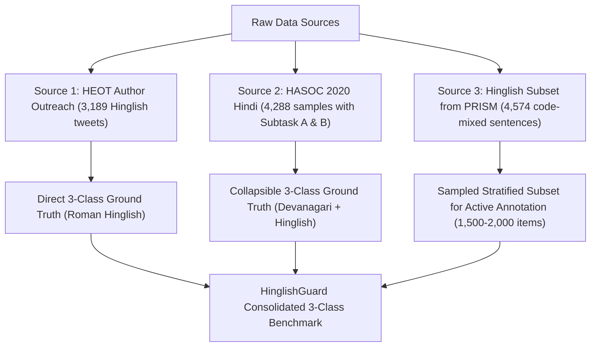

# HinglishGuard AI — Dataset Acquisition & Annotation Plan

This document provides a systematic, academically grounded dataset acquisition strategy and formal annotation guidelines for **HinglishGuard AI**.

Our core objective is **three-class Hinglish content moderation**:
- **Class 0 — Neutral**: Benign discourse, non-offensive commentary, constructive debate, casual conversation.
- **Class 1 — Offensive**: Vulgarity, profanity, uncivil insults, obscene slang, or coarse venting without identity/group targeting.
- **Class 2 — Hate**: Targeted attacks, dehumanization, threats of violence, incitement, or discrimination directed against an individual or group based on protected characteristics (religion, caste, ethnicity, nationality, gender, sexual orientation).

---

## Part 1: Investigation of Available Research Datasets

| Criterion | 1. HEOT (Mathur et al., 2018) | 2. HASOC 2020 Hindi (Mandl et al., 2020) | 3. HECM 2024 (Kapil & Ekbal, ICON 2024) | 4. Existing PRISM Dataset (`combined_hate_speech_dataset.csv`) |
| :--- | :--- | :--- | :--- | :--- |
| **Official Source / Access** | ACL Anthology: [`W18-5118`](http://aclweb.org/anthology/W18-5118); GitHub: `puneetmathur/Hinglish-Offensive-Text-Classification`. Tweet IDs require contacting primary author (`puneetmathur@alumni.cmu.edu` / `mathur16259@iiitd.ac.in`). | Official Portal: [`hasocfire.github.io/hasoc/2020`](https://hasocfire.github.io/hasoc/2020/dataset.html); FIRE 2020 track; Mirror repositories on GitHub (`roushan-raj/HASOC-2020`, `suman101112/hasoc-fire-2020`). | ACL Anthology: ICON 2024 proceedings; Paper: *"Deep Learning Models for Hate Speech Detection in Hindi-English Code-Mixed Text"*. GitHub / author correspondence (IIT Patna). | Already available locally in `data/raw/combined_hate_speech_dataset.csv`. |
| **Original Annotation Schema** | **3 Classes (Hierarchical)**:<br>• `Non-Offensive` (1,121)<br>• `Abusive` (303)<br>• `Hate-Inducing` (1,765) | **Two-Tier Schema**:<br>• Sub-task A: `NOT`, `HOF`<br>• Sub-task B: `HATE`, `OFFN`, `PRFN` (for HOF items) | **Binary Classification**:<br>• `Hateful`<br>• `Non-Hateful` | **Binary Classification**:<br>• `0` = Non-Hate<br>• `1` = Hate |
| **Language & Script** | Hinglish (Hindi-English code-mixed) in **Roman / Latin script**. | Hindi predominantly in **Devanagari script** (with minor code-mixing). | Hinglish (Hindi-English code-mixed) in **Roman / Latin script**. | Tripartite composite:<br>• 50.8% English (Latin)<br>• 33.1% Hindi (Devanagari)<br>• 16.2% Hinglish (Latin) |
| **Dataset Size** | **3,189 posts** (Train: 2,551, Test: 638). Lexicon: 209 profanity words. | **4,288 total samples**:<br>• Train: 2,963<br>• Dev: 663<br>• Test: 662 | **~9,400 tweets** (Inter-annotator agreement ~85%). | **29,550 rows** (Hinglish sentences: 4,574; Lexicon: 209; English: 15,000; Hindi: 9,767). |
| **License & Redistribution** | Academic research use only. Tweet re-distribution restricted by Twitter policies. | Free for academic & research evaluation under FIRE evaluation guidelines. | Research and non-commercial academic use (under ACL Anthology terms). | Derived from open benchmark mirrors and research lexicons for academic purposes. |
| **Direct 3-Class Support?** | **YES (Direct 1:1 match)**:<br>`Non-Offensive` $\rightarrow$ Neutral<br>`Abusive` $\rightarrow$ Offensive<br>`Hate-Inducing` $\rightarrow$ Hate | **YES (Via Sub-task A + B combination)**:<br>`NOT` $\rightarrow$ Neutral<br>`OFFN` + `PRFN` $\rightarrow$ Offensive<br>`HATE` $\rightarrow$ Hate | **NO (Binary only)**:<br>Cannot directly split Hateful into Offensive vs Hate without re-annotation. | **NO (Binary only)**:<br>Binary labels (`0` vs `1`) cannot be deterministically split into 3 classes. |
| **Scientific Defensibility of Mapping** | **High**: The taxonomy in Mathur et al. aligns directly with modern abusive vs. hate speech NLP taxonomies. | **High**: Merging `OFFN` (offensive) and `PRFN` (profane) into our target class **Offensive (Class 1)** is standard practice in HASOC literature. However, script is Devanagari Hindi. | **Unacceptable for 3-class**: Binary `Hateful` conflates general slurs with targeted hate speech. | **Unacceptable for 3-class**: Cannot split binary ground truth into 3 classes without re-annotation. |

---

## Part 2: Critical Evaluation & Gap Analysis

1. **HEOT Full Dataset (3,189 tweets)**:
   - *Status*: Ideal candidate for Hinglish Roman-script 3-class benchmark.
   - *Constraint*: The public repository contains only the 209-word lexicon. Tweet text requires rehydrating from Tweet IDs or obtaining authorized research dumps from the authors.

2. **HASOC 2020 Hindi (4,288 samples)**:
   - *Status*: Provides an established 4-class taxonomy (`NOT`, `HATE`, `OFFN`, `PRFN`) that safely collapses to 3 classes (`NOT` $\rightarrow$ Neutral; `OFFN` + `PRFN` $\rightarrow$ Offensive; `HATE` $\rightarrow$ Hate).
   - *Constraint*: Texts are primarily in **Devanagari script** rather than Romanized Hinglish. Useful for cross-lingual transfer or transliterated augmentation, but not pure Roman Hinglish.

3. **HECM 2024 (~9,400 tweets)**:
   - *Status*: Large-scale, recent Hinglish code-mixed corpus.
   - *Constraint*: Strictly binary. Mapping binary `Hateful` into `Offensive` vs `Hate` would be scientifically invalid without manual re-annotation.

4. **Existing PRISM Dataset (`combined_hate_speech_dataset.csv`)**:
   - *Status*: Large (29,550 rows), but binary and multi-lingual (only 4,783 Hinglish rows).
   - *Role*: Valuable for training strong baseline representations and binary filtering, but cannot serve as a ground-truth 3-class benchmark directly.

---

## Part 3: Recommended Acquisition & Development Roadmap

To achieve an academic-grade 3-class Hinglish moderation system without fabricating data:



1. **Step 1 — Formal Author Outreach**: Contact Puneet Mathur and Ramit Sawhney to request access to the original HEOT 3,189 Tweet ID / text dump for research purposes.
2. **Step 2 — Acquire HASOC 2020 Hindi Sub-task B**: Download and collapse `NOT`, `OFFN+PRFN`, and `HATE` to evaluate model capability on Hindi script.
3. **Step 3 — Expert Annotation of PRISM Hinglish Subset**: Take a stratified sample of 1,500 to 2,000 sentences from `hate_speech_tsv` (the Hinglish segment of our existing dataset) and annotate them using the formal guideline below.

---

## Part 4: Proposed Annotation Guideline for Three-Class Moderation

### 1. Class Taxonomy

```
[Text Input]
   │
   ├── Contains vulgarity, attacks, insults, or derogatory terms?
   │      │
   │      ├── NO  ────────► [0 = Neutral]
   │      │
   │      └── YES
   │           │
   │           ├── Is the attack directed at an individual or community based on
   │           │   PROTECTED CHARACTERISTICS (Religion, Caste, Race, Gender, Nationality)?
   │           │   OR does it include explicit dehumanization / violent threats?
   │           │      │
   │           │      ├── YES ────────► [2 = Hate]
   │           │      │
   │           │      └── NO  ────────► [1 = Offensive]
```

#### Class 0: Neutral (Normal / Benign)
- **Definition**: Statements that are non-hostile, polite, informational, factual, humorous without malice, or express disagreements without abusive language.
- **Examples**:
  - *"Bhai kal match kab shuru hoga?"* (Friendly inquiry)
  - *"Mujhe ye government policy bilkul theek nahi lagi."* (Legitimate political critique without abuse)
  - *"Arey yaar exam cancel ho gaya kya?"* (Casual conversational venting)

#### Class 1: Offensive (Abusive / Profane / Uncivil)
- **Definition**: Statements containing expletives, vulgar language, crude insults, or unconstructive personal hostility, **without** attacking a protected group identity.
- **Key Criterion**: The post is crude or aggressive, but it is **not** hate speech because it lacks identity-based malice or dehumanization.
- **Examples**:
  - *"Chup kar kutte, bakwaas band kar apni."* (Vulgar personal insult; no protected group attack)
  - *"Tu bilkul idiot hai, dimag bech ke aaya hai kya."* (Aggressive personal slight)
  - *"Kya faltu movie banayi hai bc, waste of money."* (Profane colloquial venting)

#### Class 2: Hate (Hate Speech / Targeted Malice / Incitement)
- **Definition**: Statements that attack, dehumanize, vilify, incite violence, or use slurs against individuals or communities based on protected identity attributes (religion, caste, ethnicity, nationality, gender, sexual orientation, disability).
- **Key Criterion**: Attack is grounded in group identity, promotes systemic discrimination, calls for harm/boycott of a protected group, or uses communal/identity slurs.
- **Examples**:
  - *"In sab [caste/religious group] ko desh se nikal dena chahiye."* (Expulsion / xenophobia)
  - *"Ye log aatanki hain, inka boycott karo."* (Vilification and social boycotts targeting a community)
  - Communal slurs paired with threats or derogatory stereotypes.

---

### 2. Difficult Edge Cases & Resolution Protocols

| Edge Case Scenario | Problem / Ambiguity | Resolution Rule |
| :--- | :--- | :--- |
| **A. Casual / Affectionate Slang**<br>*(e.g., "Bhai tu toh bilkul gaandu hai yaar haha")* | Cursing among close peers used in a non-threatening, conversational context. | If the overall context is overtly affectionate or humorous, classify as **1 (Offensive)** due to profanity violation, but **never 2 (Hate)**. If zero hostility is intended and used purely as banter, label **1 (Offensive)** strictly on lexical policy. |
| **B. Severe Personal Insult vs. Hate Speech**<br>*(e.g., "Teri aukaat nahi hai mujhse baat karne ki kameene")* | High aggression and vulgarity, but directed at personal behavior rather than social identity. | Classify as **1 (Offensive)**. Do **not** escalate to **2 (Hate)** unless an identity-based slur or group generalization is introduced. |
| **C. Sarcastic or Quoted Hate Speech**<br>*(e.g., "Wo bol raha tha ki sabhi X community chor hain, kitna galat hai")* | Mentioning or reporting hate speech to denounce or criticize it. | Classify as **0 (Neutral)** if the intent is clearly denouncing or reporting. If intent is ambiguous or amplifies the slur, flag for secondary review. |
| **D. Political Critique vs. Hate Speech**<br>*(e.g., "XYZ party ke neta corrupt aur nikamme hain")* | Sharp condemnation of elected politicians or institutions. | Robust political dissent is **0 (Neutral)**. If vulgar words are added (*"XYZ neta chor kamina hai"*), it is **1 (Offensive)**. It only becomes **2 (Hate)** if the critique targets the politician's religion, caste, or ethnicity rather than governance. |
| **E. Coded / Transliterated Slurs (Euphemisms)**<br>*(e.g., misspelling slurs to evade filters: "mull@", "k@tve")* | Camouflaged or phonetically obfuscated identity slurs. | Standardize via phonetic preprocessing; classify definitively as **2 (Hate)**. |

---

### 3. Rules for Resolving Inter-Annotator Disagreements

1. **Two-Annotator Baseline with Cohen's Kappa ($\kappa$)**:
   - Each text unit is independently annotated by 2 native bilingual (Hindi-English) annotators.
   - Target agreement metric: $\kappa \ge 0.80$.
2. **Third Expert Adjudicator (Tie-Breaker)**:
   - When Annotator A and Annotator B disagree (e.g., A assigns *Offensive*, B assigns *Hate*), the item is automatically routed to a designated Senior Lead Adjudicator.
   - The adjudicator's decision is final and logged with an explanatory rationale.
3. **Conservative Up-leveling for Safety**:
   - If consensus cannot be reached on whether an item is *Offensive* vs. *Hate*, the policy engine defaults to the higher severity level (**Hate**) for human moderator inspection.
